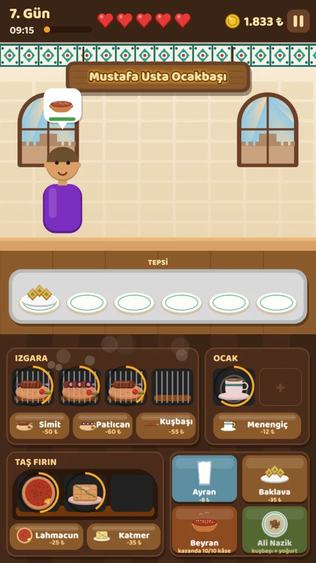
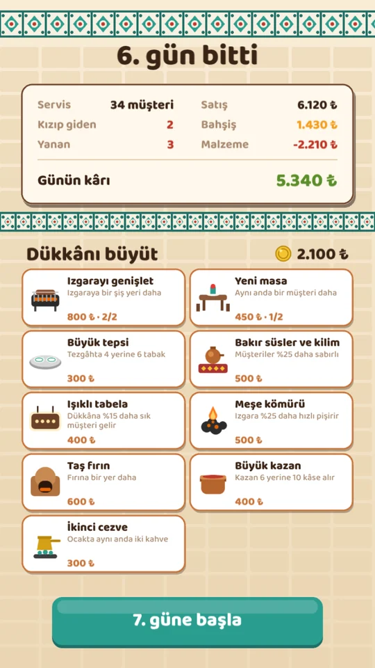
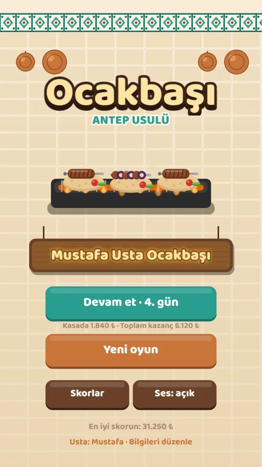
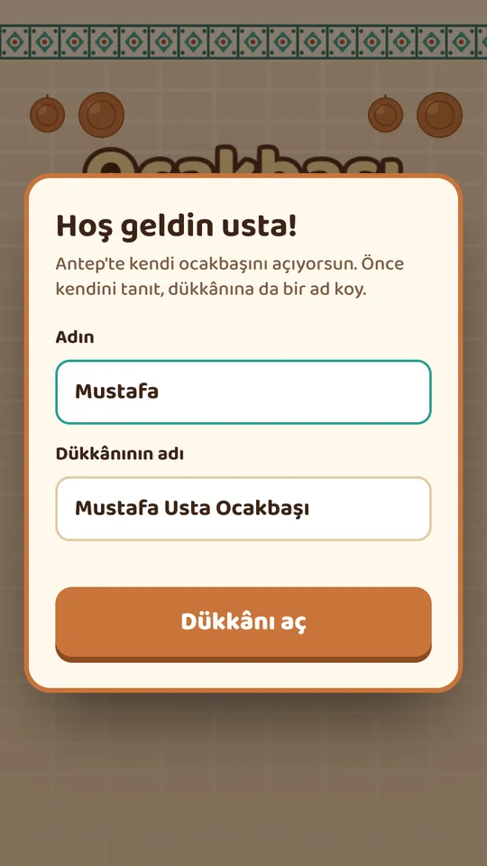
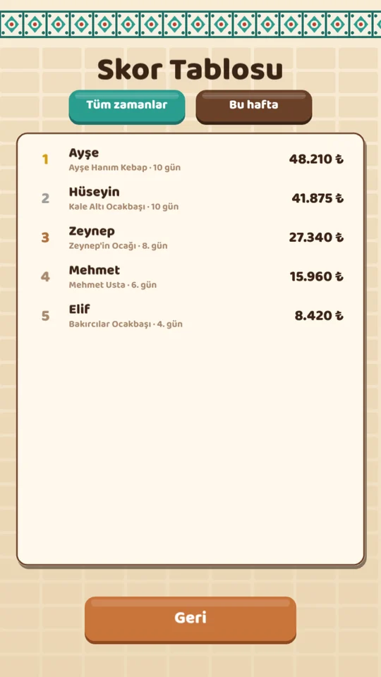

# Ocakbaşı · Antep Usulü

Antep mutfağıyla kendi ocakbaşını işlettiğin 2D bir mobil restoran oyunu. Simit kebabını ızgarada, lahmacunu taş fırında pişirirsin; beyranı kazandan dağıtır, müşterinin sabrı tükenmeden siparişi tepsiyle önüne koyarsın. Gün sonunda kazandığınla dükkânı büyütürsün. On günü tamamlayan Antep'in en iyi ustası olur.

**Tarayıcıda oyna:** https://mustafagulturk.github.io/ocakbasi/\
**Android:** [Sürümler](https://github.com/mustafagulturk/ocakbasi/releases) sayfasından `ocakbasi.apk` indirilip kurulabilir.

<p>
  
  
  
</p>

## Oyun

- **İlk açılışta** oyuncu kendi adını ve dükkânının adını girer. Dükkân tabelası, menü ve skor tablosu bu adlarla görünür; bilgiler sonradan menüden değiştirilebilir.
- **Mutfak:** Ürün butonuna dokununca malzeme parası kasadan düşer ve ürün istasyona konur. Halka dolunca pişmiştir, yanmadan dokunup tepsiye alınır. Tepsi hazırken müşteriye dokunulursa sipariş teslim edilir.
- **Menü günden güne büyür:** 1. gün simit kebabı ve ayran, ardından lahmacun, beyran, fıstıklı baklava, patlıcan kebabı, katmer, Ali Nazik (ızgarada kuşbaşı + yoğurtlu patlıcan) ve menengiç kahvesi gelir.
- **Müşteriler:** Her müşterinin bir sabır çubuğu vardır. Hızlı servis daha çok bahşiş getirir; arka arkaya memnun müşteri kaybedilen kalbi geri kazandırır. Kızıp giden müşteri bir kalp götürür, kalpler biterse dükkân kapanır.
- **Gün sonu:** Satış, bahşiş, malzeme gideri ve günün kârı gösterilir. Izgara yeri, yeni masa, büyük tepsi, meşe kömürü, ışıklı tabela gibi geliştirmeler alınır.
- **Skor:** Toplam kazanç. Bu cihazdaki en iyi oyunlar ve (sunucu bağlıysa) herkesin göründüğü haftalık / tüm zamanlar tablosu.

<p>
  
  
</p>

## Nasıl çalışıyor

```
packages/
  core/     Oyun kuralları (saf TypeScript, ekran kodu yok). Oyun ve sunucu aynı kodu kullanır.
  game/     Phaser 3 ile oyun ekranları + Capacitor ile Android uygulaması
  server/   Fastify + PostgreSQL skor sunucusu
```

**Kurallar ekrandan ayrı.** `core` paketi oyunu saniyede 10 adımlık (tik) sabit bir döngüyle ilerletir. Müşterilerin ne zaman geleceği ve ne isteyeceği, oyunun başında belirlenen bir tohumla (seed) üretilen rastgele sayılardan gelir. Aynı tohum ve aynı hamleler her zaman aynı sonucu verir.

**Skor hilesine karşı:** Oyun her hamleyi `[tik, hamle]` olarak kaydeder. Oyun bitince istemci skoru değil, bu kaydı sunucuya gönderir. Sunucu:

1. Tohumu kendisi verdiği için kaydın o oyuna ait olduğunu kontrol eder,
2. Oyunu baştan sona kendisi yeniden oynatır; kurala uymayan tek bir hamle (pişmemiş kebabı almak, tepside olmayan yemeği servis etmek vb.) varsa kaydı reddeder,
3. Skoru yeniden oynatmanın sonucundan hesaplar,
4. Günler gerçek zamanlı aktığı için oyunun, geçen süreden daha kısa sürede bitirilmiş olmasını reddeder,
5. Aynı oyunun ikinci kez gönderilmesini engeller.

Oyuncunun gizli anahtarı veritabanında düz değil, SHA-256 özeti olarak saklanır. İstek sayısı sınırlıdır (rate limit).

**Görseller kod ile çiziliyor.** Yemeklerin, müşterilerin ve simgelerin hepsi Phaser'ın çizim araçlarıyla oyun açılırken üretilir; resim dosyası yoktur. Sesler de Web Audio ile üretilir.

**Sunucu olmadan da oynanır.** `VITE_API_URL` verilmezse oyun tamamen çevrim dışı çalışır ve skorları cihazda tutar. Yarım kalan oyun her gün sonunda kaydedilir.

## Çalıştırma

```bash
npm install
npm run dev          # oyun: http://localhost:5173
npm test             # kural testleri (+ TEST_DATABASE_URL varsa API testleri)
npm run typecheck
npm run build        # packages/game/dist
```

Skor sunucusu:

```bash
docker compose up    # PostgreSQL + API: http://localhost:3000
# ya da kendi veritabanınla
DATABASE_URL=postgres://... npm run dev:server
# oyunu sunucuya bağlamak için
VITE_API_URL=http://localhost:3000 npm run dev
```

Android (Android Studio ve JDK 21 kurulu olmalı):

```bash
npm run build
cd packages/game
npx cap sync android
npx cap open android   # Android Studio'da çalıştır
```

GitHub Actions her yüklemede testleri çalıştırır, APK'yı derler, sunucunun Docker imajını dener ve web sürümünü GitHub Pages'e yayınlar. `v1.0.0` gibi bir etiket atıldığında APK, Sürümler sayfasına eklenir.

## Kendin değiştirmek istersen

Oyunun dengesi ve içeriği birkaç dosyada toplu durur:

| Ne | Nerede |
|---|---|
| Fiyatlar, malzeme maliyetleri, pişme ve yanma süreleri, yemeğin açıldığı gün | `packages/core/src/data.ts` → `PRODUCTS` |
| Gün uzunluğu, başlangıç parası, kalp sayısı | `packages/core/src/data.ts` → `DAY_SECONDS`, `START_CASH`, `MAX_HEARTS` |
| Zorluk: müşterinin gelme sıklığı, sabrı, ek sipariş ihtimali | `packages/core/src/data.ts` → `dayConfig()` |
| Geliştirmelerin fiyatı ve etkisi | `packages/core/src/data.ts` → `UPGRADES` |
| Bahşiş, sabır ve kalp kuralları | `packages/core/src/sim.ts` |
| Renkler | `packages/game/src/config.ts` → `RENK` |
| Yemek çizimleri | `packages/game/src/art.ts` → `CIZIM` |
| Mutfak yerleşimi | `packages/game/src/scenes/Kitchen.ts` → `istasyonlar()` |

**Örnek: yeni bir yemek eklemek (ör. ızgarada "Kıyma kebabı")**

1. `data.ts` içinde `ProductId` türüne `"kiyma"` ekle ve `PRODUCTS` listesine bir satır yaz:
   `kiyma: { id: "kiyma", name: "Kıyma kebabı", price: 150, cost: 55, station: "izgara", cook: 7, burn: 6, day: 5, kind: "ana" }`
2. `art.ts` içindeki `CIZIM` listesine `kiyma` için bir çizim fonksiyonu ekle (mevcut `simit` çizimini kopyalayıp renkleri değiştirmek yeter).
3. `Kitchen.ts` içinde `izgaraUrun` listesine `"kiyma"` ekle ve buton genişliğini 4 butona göre küçült.
4. `npm test` çalıştır. Testler geçiyorsa yeni yemek müşteri siparişlerine kendiliğinden girer.

Kurallarda bir değişiklik yaptıktan sonra `packages/core/test/bot.ts` içindeki otomatik oyuncu, oyunun hâlâ bitirilebilir olduğunu kontrol etmek için kullanılabilir: farklı tepki süreleriyle 10 günü oynar.

## Kullanılan teknolojiler

TypeScript, Phaser 3, Vite, Capacitor (Android), Fastify, PostgreSQL, Zod, Vitest, Docker, GitHub Actions.

## Lisans

MIT © Mustafa Gulturk
